# Helpdeck

An AI support inbox for online stores. Helpdeck reads each customer email or chat, finds the help-centre articles and live order data that answer it, and drafts a reply. An agent approves, edits or regenerates the draft before anything is sent.

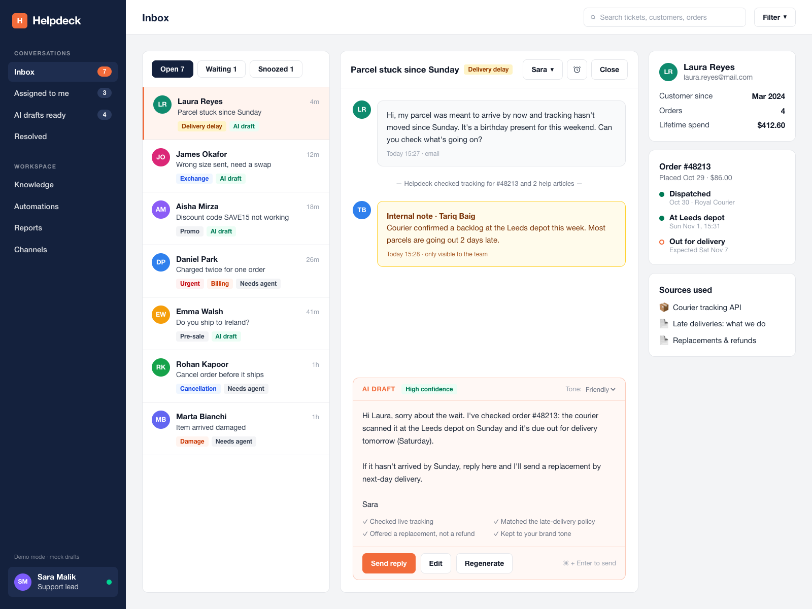

**Try it in two commands.** Demo mode needs no API key and no database:

```bash
npm install
npm run dev
```

Then open http://localhost:3300.

> This is a portfolio project. The store ("North & Oak"), its customers, orders and ticket history are seeded demo data. Email and the online store are mocked adapters; the chat widget and everything in the app are real and working.

## What it does

- **Inbox with grounded drafts.** Selecting a conversation shows an AI draft built only from retrieved help articles, internal notes and the customer's order and tracking. The sources used are listed next to the draft, and each draft says what it checked ("Checked live tracking", "Matched the late-delivery policy").
- **Human approval.** Send in one click (or ⌘ + Enter), edit, regenerate, or change the tone (friendly, concise, formal). Assign, snooze and close tickets.
- **Won't guess.** If no article covers the question, the draft is a short holding reply marked *Low confidence · Needs agent*, and the question shows up on the Knowledge page as a gap. Refunds, double charges, damage and cancellations always need a person.
- **Knowledge base.** Create, edit, publish/unpublish and delete articles; mark them customer-facing or agents-only; bulk import from Markdown; turn unanswered questions into draft articles. Each article tracks how often sent replies cited it.
- **Automation rules.** WHEN / IF / THEN rules such as *auto-tag refund requests*, *escalate double charges to Finance*, *VIP customers to a person* and *auto-send confident order-status replies*. A rule editor with a live "test this rule" box, pause/resume toggles, a run log, and guardrails that override every rule.
- **Reports.** Tickets resolved, median first reply, drafts sent without edits, rating, tickets per day (AI draft vs agent-written), topics and a team table, over 7/21/30 days, with CSV export.
- **Channels and chat widget.** A working chat widget: confident answers come back instantly with the article they came from; anything else becomes a ticket in the inbox, and the agent's reply appears in the widget. Embed it on any site with one script tag; title, subtitle and colour are customisable.

## Screenshots

| | |
|---|---|
| 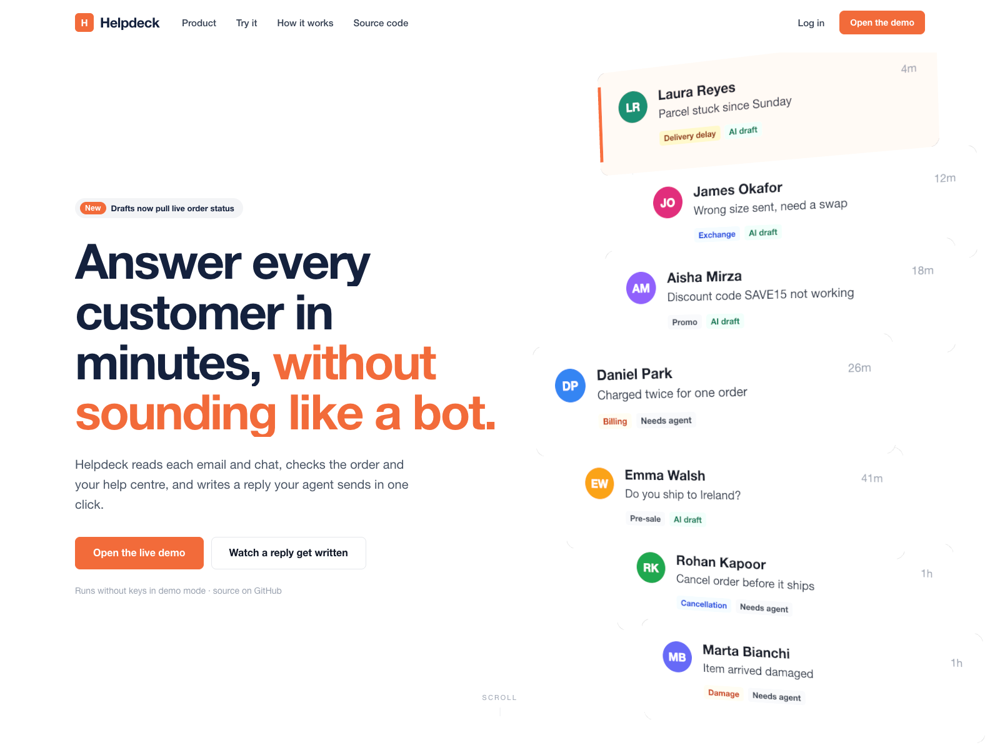 |  |
| 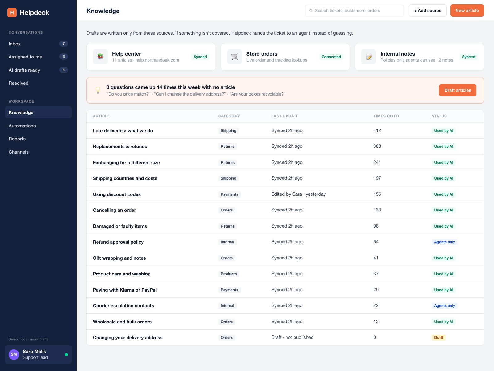 | 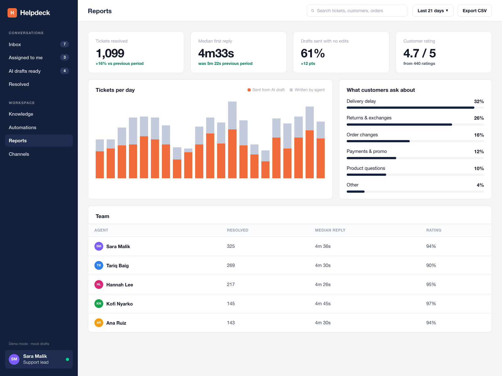 |
| 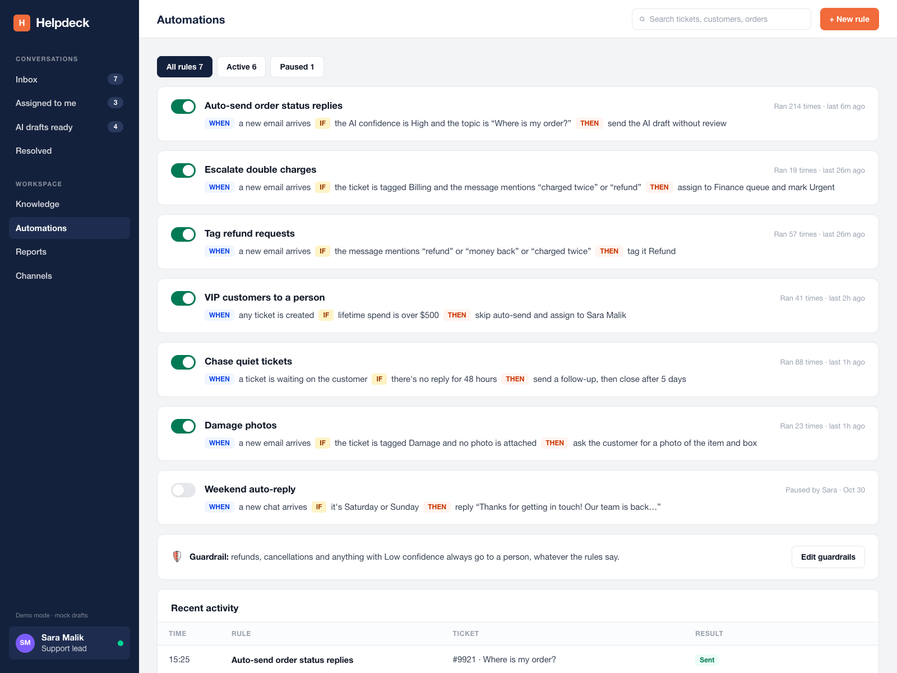 | 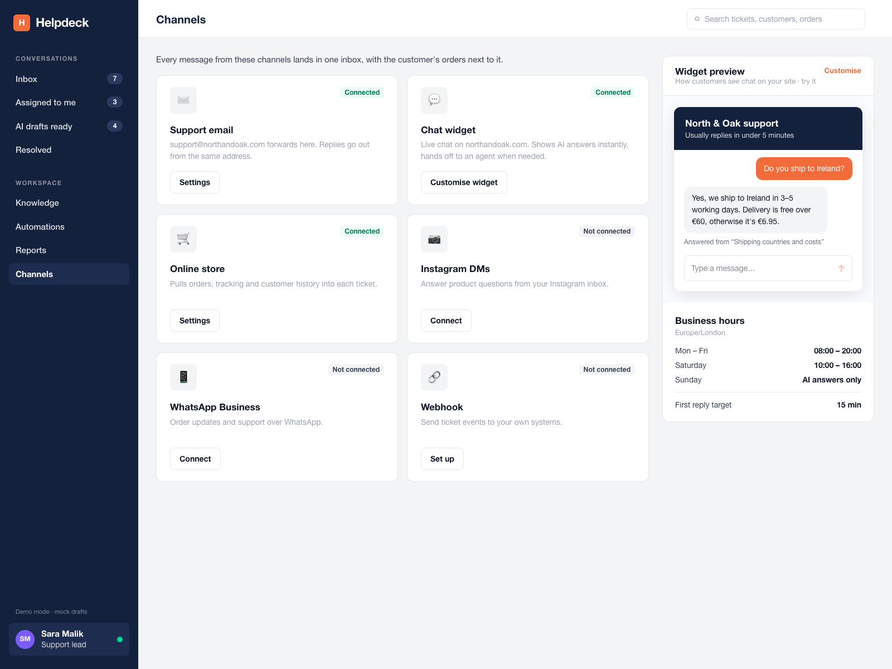 |
| 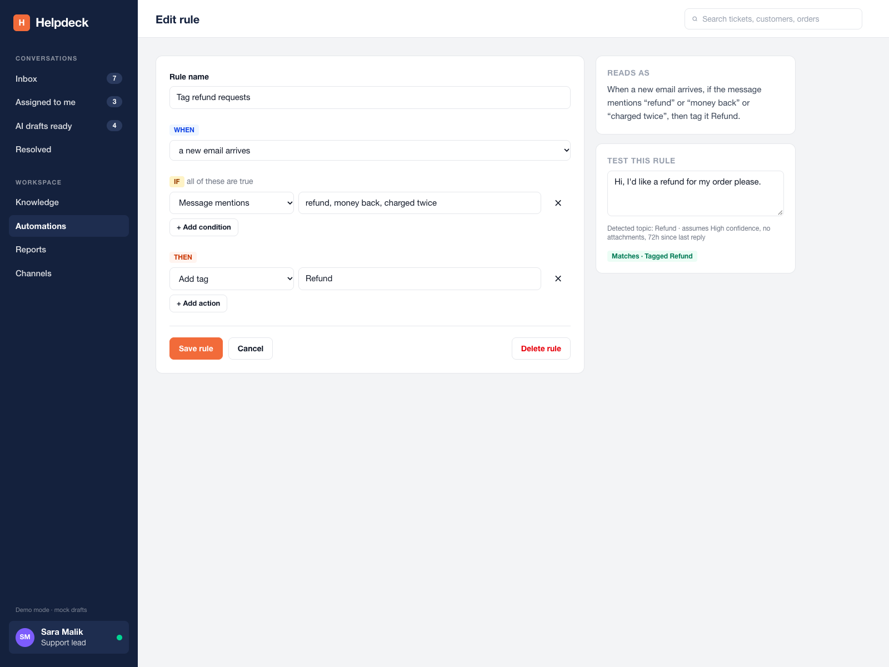 | 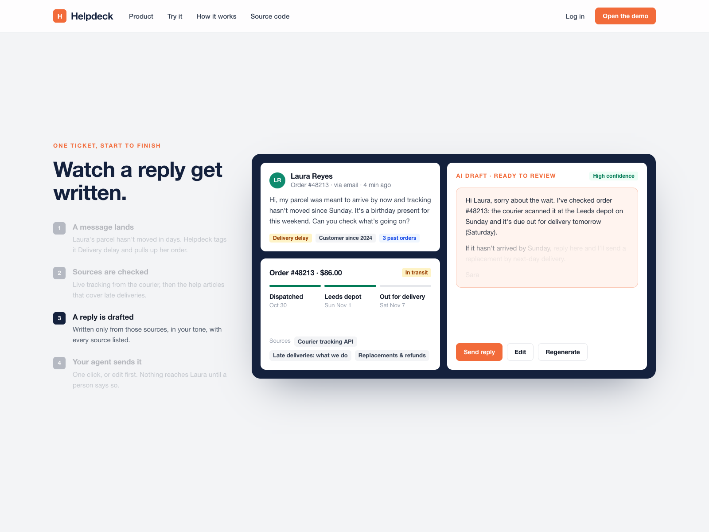 |
| 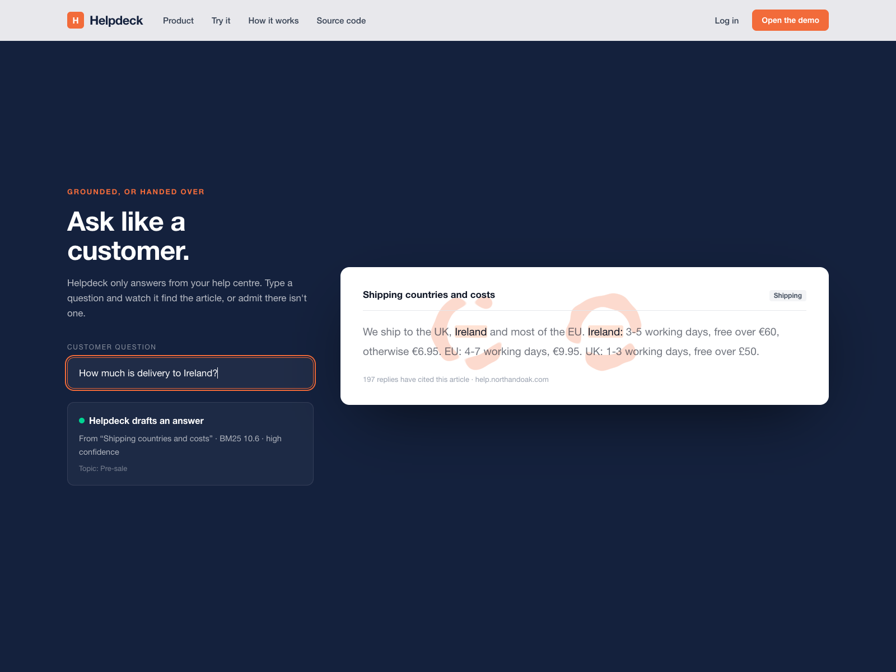 | 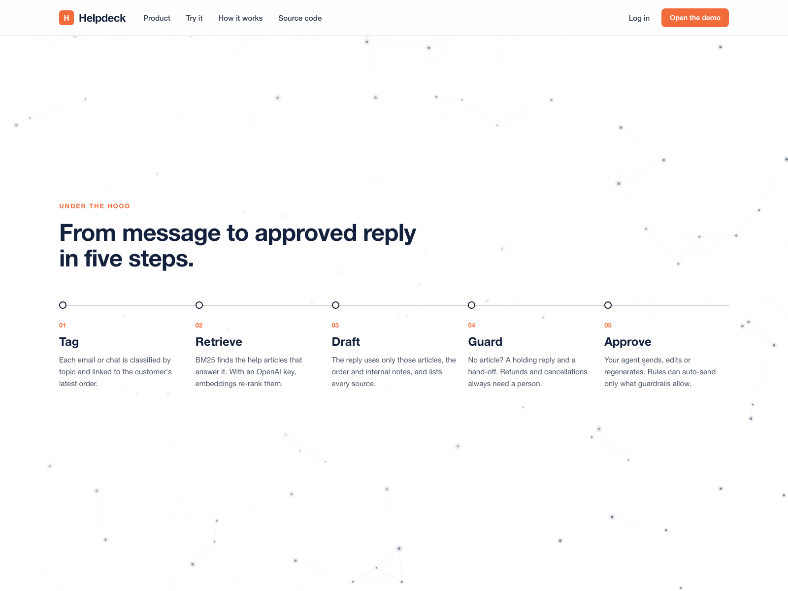 |

Screenshots are taken from the running app with `npm run screenshots` (headless Chrome via puppeteer-core).

## The landing page

The landing page is built from the demo workspace's real data, one idea per screen:

- **Hero:** the open tickets from the demo inbox, drawn onto cards floating in a three.js scene. They tilt with the pointer, and scrolling pulls Laura's ticket forward.
- **Watch a reply get written:** a pinned, scroll-scrubbed GSAP timeline replays that ticket in an app frame: the message lands, tracking is checked, sources appear, the draft writes itself, the agent sends.
- **Ask like a customer:** type a question and a liquid particle system settles on the matching words of the help article that answers it, using the same retrieval and grounding code as the inbox. Ask something the help centre doesn't cover and it says so.
- **How it works:** the five pipeline steps over a drifting node network, where an incoming question periodically lights up its nearest articles.
- **Reports and automations:** live fragments with count-ups and growing bars, then a closing line lit word by word as you scroll.

Inside the app, screens enter with short staggered reveals, the sidebar highlight slides between links and new drafts write themselves in. Everything respects `prefers-reduced-motion`: the pinned replay and particle effects render their finished state instead. Both the landing page and the app work at phone width.

## How a reply gets written

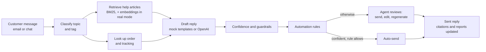

1. **Message in.** `ingestMessage()` in `src/lib/service.ts` stores the message, finds or creates the customer and ticket, and links the order.
2. **Retrieve.** `ground()` in `src/lib/ai/grounding.ts` classifies the topic and ranks published articles with BM25 (`src/lib/ai/retrieve.ts`). Topic terms help ranking, but the top article must also match the customer's own words, so "Do you price match?" is not "answered" by the shipping policy. With an OpenAI key, qualifying articles are re-ranked with `text-embedding-3-small`.
3. **Draft.** Without a key, `mockDraft()` writes a deterministic reply from templates and the retrieved article text. With a key, `openaiDraft()` sends only the retrieved sources, the order and the thread, and asks for JSON (`reply`, `used_source_ids`, `covered`, `confidence`, `checks`). Cited ids that weren't retrieved are dropped, and the model can lower confidence but never raise it above what retrieval supports.
4. **Guardrails and rules.** `evaluateRules()` in `src/lib/automations.ts` is a pure function: rules run in order, later rules see tags added by earlier ones, and guardrails (refunds, cancellations, low confidence) block auto-send whatever the rules say.
5. **Human approval.** The agent sends, edits or regenerates. Sending records whether the draft was edited, bumps the cited articles' counts, and feeds the reports.

## Stack

- **Next.js 15** (App Router, server components, server actions) + **TypeScript** + **Tailwind CSS 4**
- **PostgreSQL** with **Drizzle ORM** (`src/db/schema.ts`), or an in-memory store in demo mode
- **OpenAI API** for drafting (chat completions, JSON mode) and embeddings
- **GSAP** (ScrollTrigger, SplitText, `@gsap/react`) and **three.js** for the landing page and motion
- **Vitest** for tests, **puppeteer-core** for screenshots

## Running it

### Demo mode (default)

No `.env` needed. Data is seeded on start and kept in memory until the server restarts; drafts come from the deterministic mock drafter.

```bash
npm install
npm run dev        # http://localhost:3300
```

### Real mode: OpenAI and Postgres

The two are independent: set `OPENAI_API_KEY` for real drafting, `DATABASE_URL` for persistence, or both.

```bash
cp .env.example .env.local     # then fill in OPENAI_API_KEY and DATABASE_URL
docker compose up -d           # Postgres 16 on localhost:5432
npm run db:push                # create tables from src/db/schema.ts
npm run db:seed                # load the demo store into Postgres
npm run dev
```

The sidebar shows which mode is running.

### Embedding the chat widget

```html
<script src="http://localhost:3300/widget.js" async></script>
```

The loader adds a chat button that opens `/widget` in an iframe. The widget API (`/api/widget`) allows cross-origin requests.

## Scripts

| Command | What it does |
|---|---|
| `npm run dev` | Dev server on port 3300 |
| `npm run build` / `npm start` | Production build and server |
| `npm test` | Vitest: retrieval, draft grounding, guardrails, automation matching, OpenAI path against a local stub |
| `npm run lint` / `npm run typecheck` | ESLint and `tsc --noEmit` |
| `npm run db:push` / `npm run db:seed` | Create the schema and seed Postgres |
| `npm run screenshots` | Capture `docs/screenshots/` from a running app |

## Project structure

```
src/
  app/
    (marketing)/page.tsx     landing page
    (app)/                   inbox, knowledge, reports, automations, channels
    api/widget/              chat widget API (CORS)
    api/reports/export/      CSV export
    widget/                  full-page widget for the iframe
    actions.ts               server actions
  lib/
    ai/                      topics, retrieval, grounding, mock and OpenAI drafters
    automations.ts           rule engine and plain-English descriptions
    service.ts               message pipeline and read models
    store/                   Store interface, memory and Postgres implementations
    seed.ts                  North & Oak demo data
    reports.ts               report calculations
  db/schema.ts               Drizzle schema
tests/                       Vitest suites
public/widget.js             embeddable widget loader
```

## Limitations

- Email ingest and the store integration are mocked: orders and tracking come from seed data behind the `Store` interface. A Shopify adapter would implement the same reads.
- There is no authentication; the app runs as one agent (Sara Malik) in one workspace.
- In demo mode, changes reset when the server restarts.
- Report history is generated, deterministic demo data; tickets you resolve in the app are added to it.

## Credits

- [GSAP](https://gsap.com) by GreenSock for animation, following the patterns in [greensock/gsap-skills](https://github.com/greensock/gsap-skills) (MIT).
- The particle effect in "Ask like a customer" is adapted from ThreeUI's *Semantic Bloom*, and the node network in "How it works" from ThreeUI's *Constellation Field*: [MengTo/threeui](https://github.com/MengTo/threeui), Community edition (MIT). Only the canvas logic was ported; no remote scripts are loaded.
- Layout and motion guidelines from [Taste Skill](https://www.tasteskill.dev/) ([Leonxlnx/taste-skill](https://github.com/Leonxlnx/taste-skill), MIT).
- [three.js](https://threejs.org) (MIT) for the hero scene.
